I produce and edit video at **Band (Grupo Bandeirantes)**, where I built a
digital-novela workflow that runs end to end on generative AI — LLM-written
scripts, generated avatars and environments, synthesized voice. I'm studying
**Computer Science at FIAP** and moving the same instinct into software: if a
step is boring and repeats three hundred times, it should be a script.

I started in hardware, not in an editor. That order still shows in how I work.

São Paulo, Brazil.

---

### What I'm working on

**GoodWe Enterprise Challenge** — FIAP's company-partnered programme with GoodWe,
run in sprints against a real brief in solar energy. The closest thing to
professional IT work I've done inside the degree: real constraints, real
stakeholders, real deadlines.
<!-- TODO Luiz: troque a frase acima pela sua entrega concreta — o que o seu grupo
     construiu, qual problema, qual stack. Uma frase basta. Eu deixei no nível do
     programa porque não sei o que vocês entregaram, e não vou inventar. -->

**Quantum machine learning** — undergraduate research on a hybrid
classical-quantum pipeline: a ResNet feature extractor feeding a variational
quantum circuit, in PennyLane. Learning Qiskit and QASM alongside it. This is
where I want to end up.

**[O.R.B.I.T.A.](https://github.com/ShendonC/O.R.B.I.T.A.-GS2026.1---Luiz-Marcelo)**
— mission-control platform: real-time telemetry, risk classification, energy
management and an AI agent for critical-situation analysis. Python,
CustomTkinter, Gemini. Built with Marcelo Martins for FIAP's Global Solution
2026.1.
<!-- Se quiser creditar o @ do GitHub do Marcelo, troque o nome por [@usuario](url).
     Não coloquei porque não sei o usuário dele e não vou chutar. -->

**Local AI orchestration** — a setup that pairs a planning model with a local
executor running on my own hardware, so the expensive model designs and the
cheap one does the typing.

---

### Hardware

**SlimeVR trackers, from zero.** Soldered the modules myself, flashed and
programmed them, and went into the source to fix bugs I ran into. Full-body VR
tracking that works because I made it work, not because I bought it.

**Mechatronics technician** (FORTEC). Built the remote control for a car the
team assembled — the whole loop, from the board to the thing moving across the
floor.

Soldering iron first, IDE second. It is a good order: you stop treating
software as the only place a problem can live.

---

### Stack

```
Python          main language — automation, ML, tooling
PennyLane       hybrid quantum-classical circuits
Qiskit / QASM   learning
JavaScript      vanilla, no-build front ends
Embedded        firmware, soldering, sensor work
Premiere · After Effects · DaVinci Resolve
```

I have a bias against dependencies. The portfolio below is a bilingual site
with animated colour grading, a working vectorscope and a Playwright test
harness — and zero npm packages.

---

### Elsewhere

| | |
|---|---|
| Portfolio | [portfolio.luizfreixo.workers.dev](https://portfolio.luizfreixo.workers.dev) |
| LinkedIn | [/luiz-otavio-brito-freixo](https://www.linkedin.com/in/luiz-otavio-brito-freixo) |
| Email | luiz.otavdm@gmail.com |

<sub>The banner is a single self-hosted SVG. No third-party badge services — they
go down and take your profile with them.</sub>
